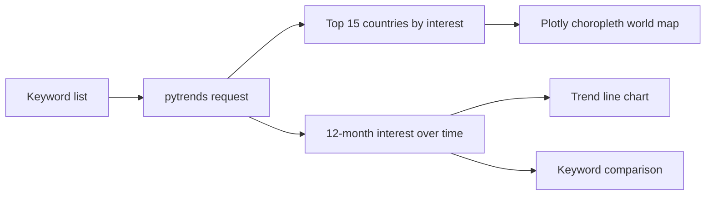

# Google Search Trends Analysis with Python

How does global interest in technology topics change over time and across countries? This notebook pulls data from Google Trends and explores keywords such as "cloud computing", "data science" and "machine learning".



## What the notebook does

- **Top countries:** ranks the 15 countries searching most for a keyword.
- **World map:** draws a Plotly choropleth of country-level interest.
- **Trend over time:** plots interest in a keyword across the last 12 months.
- **Keyword comparison:** overlays several keywords to compare their trends.
- **Reusable:** change the keyword list and rerun.

## Files

| File | Purpose |
|---|---|
| `Google Search Analysis.ipynb` | The analysis notebook |
| `Google-Search-Trends-Analysis-Global-Technology-Interest-Patterns.pdf` | Written report |
| `Global_Search_Trends_Project_Presentation.pptx` | Presentation slides |

## Run it

```bash
pip install pytrends pandas matplotlib seaborn plotly jupyter
jupyter notebook "Google Search Analysis.ipynb"
```

Google Trends values are relative (0 to 100) and change over time, so a fresh run will not match old outputs exactly.

## Stack

`Python` `pytrends` `pandas` `Matplotlib` `Seaborn` `Plotly`
